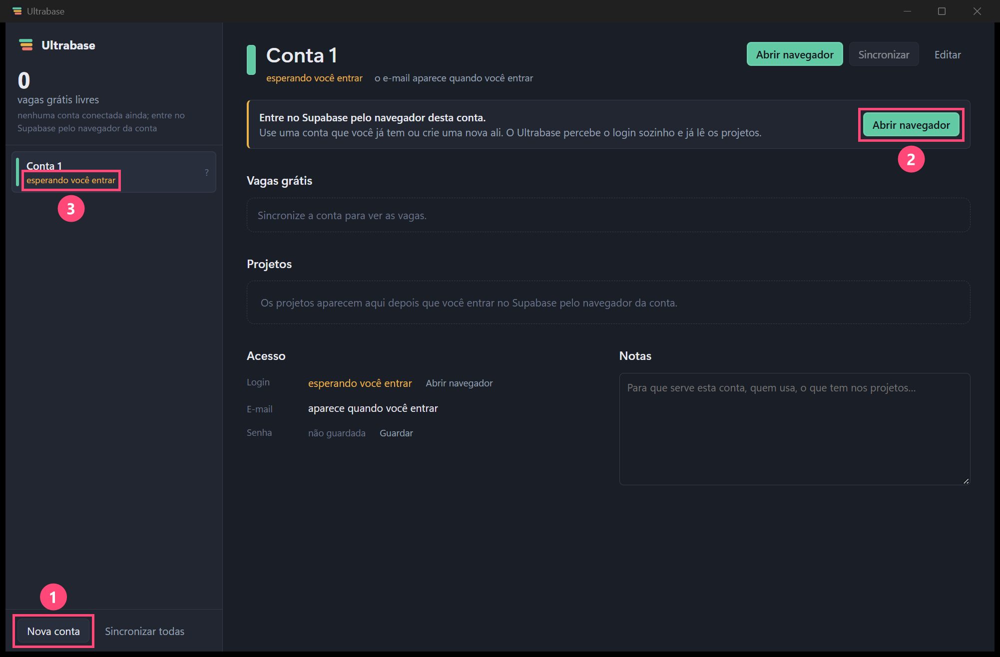

# Ultrabase

Organizador de várias contas do Supabase no Windows. Cada conta mora num navegador próprio, com login separado das outras, e o app mostra os projetos de cada uma, as vagas grátis e quando cada projeto vai pausar. Um clique copia tudo de um projeto (chaves, banco, conexões) para a IA da sua IDE.



## O que faz

- **Um navegador por conta.** Cada conta tem um perfil do WebView2 com pasta própria: login, cookies e dados não se misturam, e a sessão continua depois de fechar o app.
- **Nova conta sem formulário.** O botão abre um navegador novo na página de login do Supabase. Quando você entra, o app percebe sozinho e lê e-mail, organizações e projetos.
- **Vagas grátis.** Mostra quantos dos 2 projetos grátis de cada conta estão em uso (o limite conta todas as organizações onde a conta é dona ou admin) e sugere a conta para o próximo projeto.
- **Pausa.** Estima em quantos dias cada projeto grátis pausa (1 semana sem uso) e deixa pausar e acordar projetos.
- **Copiar para IA.** Monta um texto com o `.env` completo, as conexões do Postgres (pooler e direta), o jeito de a IA usar a API do Supabase com o token e uma configuração opcional de MCP.
- **Segredos no cofre do Windows.** Senha, token de acesso e senha do banco ficam no Gerenciador de Credenciais, não em arquivo.

## Como rodar

Precisa de Windows 10 ou 11 (com WebView2), Rust estável e Node 20 ou mais novo.

```bash
npm install
npm run tauri dev
```

Para gerar o executável (fica em `src-tauri/target/release/ultrabase.exe`):

```bash
npx tauri build --no-bundle
```

A interface também abre no navegador, com dados de mentira, para mexer no visual: rode `npm run dev` e abra `http://localhost:1420/?demo`.

## Como funciona

- **Login:** o painel do Supabase guarda a sessão no `localStorage` (chave `supabase.dashboard.auth.token`). O app lê essa sessão de dentro da janela da conta e usa o `access_token` nas mesmas rotas que o painel usa (`api.supabase.com/platform/...`). Com um token pessoal, usa a API pública `/v1`.
- **Dados locais:** banco SQLite e perfis dos navegadores em `%APPDATA%\com.floriani.ultrabase`.
- **Código:** Rust em `src-tauri/src` (Tauri 2, rusqlite, reqwest, keyring) e interface em Svelte 5 em `src`. O desenho completo está em [`docs/superpowers/specs/2026-11-09-ultrabase-design.md`](docs/superpowers/specs/2026-11-09-ultrabase-design.md).

## Avisos

- As rotas `/platform` são internas do painel do Supabase e não são documentadas: podem mudar sem aviso.
- "Copiar para IA" coloca chaves secretas (service_role, secret, JWT secret, senha do banco) na área de transferência.
- O token de acesso vale para a conta inteira do Supabase, não só para um projeto.
- Projeto pessoal, sem ligação com a Supabase.
